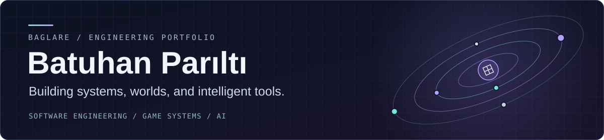

[**ArtifactHub**](https://artifacthub.baglare.com.tr/) · [LinkedIn](https://www.linkedin.com/in/baglare/) · [Türkçe](README.tr.md)

## About

I am a final-year Computer Engineering student at İzmir Bakırçay University. I build software across game development, full-stack applications, developer tools, and applied AI.

My interests lie in the systems behind the interface: gameplay architecture, data integrity, local-first design, deterministic processing, model evaluation, and reliable release workflows. I enjoy taking an idea from experiment to a usable product and understanding the trade-offs along the way.

[ArtifactHub](https://artifacthub.baglare.com.tr/) is my technical portfolio: architecture, design decisions, implemented scope, evidence, and known limitations for each project.

## Project index

Projects are grouped by engineering domain rather than ranked. Status labels distinguish deployed products, released tools, active development, and experimental work.

### Game development

| Project | Status | Engineering focus |
| --- | --- | --- |
| [Fly Butterfly](https://artifacthub.baglare.com.tr/artifacts/butterfly-effect/) | Graduation project · in development | Two-player, dual-era Unity game with networked state, deterministic causality, and player-specific knowledge. Unity, C#, Netcode for GameObjects. |
| [PulseForge](https://github.com/Baglare/PulseForge) · [Case study](https://artifacthub.baglare.com.tr/artifacts/pulseforge/) | Prototype | Turns user-selected audio into rhythm-combat encounters through onset and beat analysis, seeded planning, and DSP-based timing. Unity, C#, FFmpeg. |
| [TempoBlade](https://github.com/Baglare/TempoBlade) · [Case study](https://artifacthub.baglare.com.tr/artifacts/tempoblade/) | Prototype | Tempo-driven action roguelite with parry/deflect, data-driven weapons, encounters, and progression. Unity, C#, ScriptableObjects. |

### Full-stack & applications

| Project | Status | Engineering focus |
| --- | --- | --- |
| [ArtifactHub](https://github.com/Baglare/ArtifactHub) · [Website](https://artifacthub.baglare.com.tr/) | Portfolio website | Bilingual, registry-driven technical portfolio with static export and structured project case studies. Next.js, TypeScript, Tailwind CSS. |
| [DersOyun](https://baglare.github.io/) · [Case study](https://artifacthub.baglare.com.tr/artifacts/dersoyun/) | Public study app | Offline-capable learning PWA with a shared quiz engine, progress tracking, practice exams, and automated regression tests. React, TypeScript, Vite. |
| [MediaTracker](https://github.com/Baglare/MediaTracker) · [Live app](https://mediatracker.baglare.com.tr/) · [Case study](https://artifacthub.baglare.com.tr/artifacts/media-tracker/) | Live product | Local-first media tracking, optional account sync, revision and conflict handling, PostgreSQL row-level security, and social features. Next.js, TypeScript, PostgreSQL, Better Auth. |

### Artificial intelligence

| Project | Status | Engineering focus |
| --- | --- | --- |
| [AgentVerse](https://github.com/Baglare/AgentVerse) · [Case study](https://artifacthub.baglare.com.tr/artifacts/agentverse/) | Research prototype | Persistent agent identities, versioned learned skills, seeded reinforcement learning, and controlled transfer experiments. Python, Gymnasium, Q-learning. |
| [Aria AI](https://artifacthub.baglare.com.tr/artifacts/aria-ai/) | Early-stage prototype | Local-first desktop AI foundation with streaming, cancellation, provider boundaries, and backend-managed credentials. Tauri, React, FastAPI, SQLite, Ollama. |
| [OpenAI Image Studio](https://artifacthub.baglare.com.tr/artifacts/openai-image-studio/) | Personal tool prototype | Single-user image generation and reference-image editing with server-side API calls, local history, and estimated usage costs. Next.js, TypeScript. |
| [VoxForge](https://github.com/Baglare/VoxForge) · [Case study](https://artifacthub.baglare.com.tr/artifacts/voxforge/) | In development | Local Turkish TTS and narration studio with multi-character voices, engine benchmarking, quality checks, and alternative takes. Python, VoxCPM2, XTTS-v2, Chatterbox, faster-whisper. |

### Computer vision

| Project | Status | Engineering focus |
| --- | --- | --- |
| [Clothing Classification](https://artifacthub.baglare.com.tr/artifacts/kiyafet-kategorilendirme/) | Team course project · in development | Garment segmentation, attribute and subtype classification, comparative model evaluation, and camera-based experimentation. Python, PyTorch, YOLO, RF-DETR, DINOv2. |
| [VisionForge](https://github.com/Baglare/VisionForge) · [Case study](https://artifacthub.baglare.com.tr/artifacts/visionforge/) | Interactive prototype | Local face and hand tracking, gesture-driven spells, threaded camera processing, and a portable desktop interface. Python, OpenCV, MediaPipe, PySide6. |

### Developer tools & localization

| Project | Status | Engineering focus |
| --- | --- | --- |
| [GameLocalizer](https://artifacthub.baglare.com.tr/artifacts/gamelocalizer/) | Release candidate | Format-aware localization, translation memory, structural QA, and verifiable, reversible game patches. Python, SQLite, PySide6. |
| [Petglare](https://github.com/Baglare/ClaudePetGlare) · [Download](https://github.com/Baglare/ClaudePetGlare/releases/latest) · [Workshop](https://github.com/Baglare/Petglare-Workshop) | Released tool | Windows desktop companion for Claude Code with session status, configurable mascots, local image editing, and a curated community catalog. C#, .NET, WPF. |
| [PoD Localization Engineering](https://github.com/Baglare/PoD-Localization-Engineering) · [Case study](https://artifacthub.baglare.com.tr/artifacts/pod-localization-engineering/) | Engineering showcase | Public synthetic demonstration of protected localization syntax, deterministic packaging, structural QA, and checksum verification from a larger private localization workflow. Python. |

For projects with private source repositories, the linked ArtifactHub page documents the publicly shareable scope. Prototype and research labels are intentional; they do not imply production readiness or completed experiments.

## Technical toolkit

| Area | Technologies |
| --- | --- |
| Languages | Python, C#, TypeScript, Java, SQL |
| Applications | Unity, Next.js, React, Vite, FastAPI, Tauri, WPF, PySide6 |
| Data & infrastructure | PostgreSQL, SQLite, Git, GitHub Actions |
| AI, audio & vision | PyTorch, Gymnasium, OpenCV, MediaPipe, FFmpeg, faster-whisper, local TTS engines |
| Engineering practices | Automated testing, deterministic pipelines, data validation, architecture documentation, controlled release workflows |

---

[ArtifactHub — explore the technical case studies](https://artifacthub.baglare.com.tr/)
