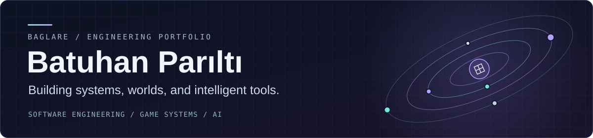

[**ArtifactHub**](https://artifacthub.baglare.com.tr/) · [LinkedIn](https://www.linkedin.com/in/baglare/) · [English](README.md)

## Hakkımda

İzmir Bakırçay Üniversitesi Bilgisayar Mühendisliği son sınıf öğrencisiyim. Oyun geliştirme, full-stack uygulamalar, geliştirici araçları ve uygulamalı yapay zekâ alanlarında yazılım geliştiriyorum.

Özellikle arayüzün arkasındaki sistemlerle ilgileniyorum: oynanış mimarisi, veri bütünlüğü, yerel öncelikli tasarım, deterministik işleme, model değerlendirme ve güvenilir yayın süreçleri. Bir fikri deney aşamasından kullanılabilir bir ürüne taşımayı ve bu süreçteki mühendislik kararlarını anlamayı seviyorum.

[ArtifactHub](https://artifacthub.baglare.com.tr/), projelerimin mimarisini, tasarım kararlarını, uygulanmış kapsamını, kanıtlarını ve bilinen sınırlarını belgelediğim teknik portföyüm.

## Proje dizini

Projeler önem sırasına göre değil, mühendislik alanlarına göre gruplandırılmıştır. Durum etiketleri canlı ürünleri, yayımlanmış araçları, geliştirme aşamasındaki projeleri ve deneysel çalışmaları birbirinden ayırır.

### Oyun geliştirme

| Proje | Durum | Mühendislik odağı |
| --- | --- | --- |
| [Fly Butterfly](https://artifacthub.baglare.com.tr/artifacts/butterfly-effect/) | Bitirme projesi · geliştirmede | Ağ üzerinden yönetilen oyun durumu, deterministik nedensellik ve oyuncuya özel bilgi sistemleri içeren iki oyunculu, iki dönemli Unity oyunu. Unity, C#, Netcode for GameObjects. |
| [PulseForge](https://github.com/Baglare/PulseForge) · [Teknik inceleme](https://artifacthub.baglare.com.tr/artifacts/pulseforge/) | Prototip | Kullanıcının seçtiği müzikten onset ve beat analizi, seed tabanlı planlama ve DSP zamanlamasıyla ritim-dövüş karşılaşmaları üretir. Unity, C#, FFmpeg. |
| [TempoBlade](https://github.com/Baglare/TempoBlade) · [Teknik inceleme](https://artifacthub.baglare.com.tr/artifacts/tempoblade/) | Prototip | Parry/deflect, veri odaklı silahlar, karşılaşmalar ve ilerleme sistemleri içeren tempo tabanlı aksiyon roguelite. Unity, C#, ScriptableObject. |

### Full-stack ve uygulamalar

| Proje | Durum | Mühendislik odağı |
| --- | --- | --- |
| [ArtifactHub](https://github.com/Baglare/ArtifactHub) · [Web sitesi](https://artifacthub.baglare.com.tr/) | Portföy sitesi | Statik derleme, veri odaklı proje envanteri ve yapılandırılmış teknik incelemeler içeren iki dilli portföy. Next.js, TypeScript, Tailwind CSS. |
| [DersOyun](https://baglare.github.io/) · [Teknik inceleme](https://artifacthub.baglare.com.tr/artifacts/dersoyun/) | Herkese açık çalışma uygulaması | Ortak soru motoru, ilerleme takibi, deneme sınavları ve otomatik regresyon testleriyle çevrimdışı çalışabilen öğrenme PWA'sı. React, TypeScript, Vite. |
| [MediaTracker](https://github.com/Baglare/MediaTracker) · [Canlı uygulama](https://mediatracker.baglare.com.tr/) · [Teknik inceleme](https://artifacthub.baglare.com.tr/artifacts/media-tracker/) | Canlı ürün | Yerel öncelikli medya takibi, isteğe bağlı hesap eşitlemesi, revizyon ve çakışma yönetimi, PostgreSQL satır düzeyinde güvenlik ve sosyal özellikler. Next.js, TypeScript, PostgreSQL, Better Auth. |

### Yapay zekâ

| Proje | Durum | Mühendislik odağı |
| --- | --- | --- |
| [AgentVerse](https://github.com/Baglare/AgentVerse) · [Teknik inceleme](https://artifacthub.baglare.com.tr/artifacts/agentverse/) | Araştırma prototipi | Kalıcı ajan kimlikleri, sürümlü öğrenilmiş beceriler, seed tabanlı pekiştirmeli öğrenme ve kontrollü beceri transferi deneyleri. Python, Gymnasium, Q-learning. |
| [Aria AI](https://artifacthub.baglare.com.tr/artifacts/aria-ai/) | Erken aşama prototipi | Akışlı yanıtlar, iptal mekanizması, sağlayıcı sınırları ve backend tarafından yönetilen kimlik bilgileriyle yerel öncelikli masaüstü AI altyapısı. Tauri, React, FastAPI, SQLite, Ollama. |
| [OpenAI Image Studio](https://artifacthub.baglare.com.tr/artifacts/openai-image-studio/) | Kişisel araç prototipi | Sunucu tarafı API çağrıları, yerel geçmiş ve tahmini kullanım maliyetleriyle tek kullanıcılı görsel üretme ve referans görsel düzenleme aracı. Next.js, TypeScript. |
| [VoxForge](https://github.com/Baglare/VoxForge) · [Teknik inceleme](https://artifacthub.baglare.com.tr/artifacts/voxforge/) | Geliştirmede | Çok karakterli seslendirme, motor karşılaştırmaları, kalite denetimi ve alternatif ses üretimleri içeren yerel Türkçe TTS stüdyosu. Python, VoxCPM2, XTTS-v2, Chatterbox, faster-whisper. |

### Bilgisayarlı görü

| Proje | Durum | Mühendislik odağı |
| --- | --- | --- |
| [Kıyafet Kategorilendirme](https://artifacthub.baglare.com.tr/artifacts/kiyafet-kategorilendirme/) | Ekip ders projesi · geliştirmede | Kıyafet segmentasyonu, özellik ve alt tür sınıflandırması, karşılaştırmalı model değerlendirmesi ve kamera deneyleri. Python, PyTorch, YOLO, RF-DETR, DINOv2. |
| [VisionForge](https://github.com/Baglare/VisionForge) · [Teknik inceleme](https://artifacthub.baglare.com.tr/artifacts/visionforge/) | Etkileşimli prototip | Yerel yüz ve el takibi, hareket tabanlı büyü komutları, ayrı iş parçacığında kamera işleme ve taşınabilir masaüstü arayüzü. Python, OpenCV, MediaPipe, PySide6. |

### Geliştirici araçları ve yerelleştirme

| Proje | Durum | Mühendislik odağı |
| --- | --- | --- |
| [GameLocalizer](https://artifacthub.baglare.com.tr/artifacts/gamelocalizer/) | Sürüm adayı | Dosya formatına duyarlı yerelleştirme, çeviri hafızası, yapısal kalite kontrolü ve doğrulanabilir, geri alınabilir oyun yamaları. Python, SQLite, PySide6. |
| [Petglare](https://github.com/Baglare/ClaudePetGlare) · [İndir](https://github.com/Baglare/ClaudePetGlare/releases/latest) · [Workshop](https://github.com/Baglare/Petglare-Workshop) | Yayımlanmış araç | Claude Code için oturum durumlarını, özelleştirilebilir maskotları, yerel görsel düzenlemeyi ve topluluk kataloğunu birleştiren Windows masaüstü uygulaması. C#, .NET, WPF. |
| [PoD Localization Engineering](https://github.com/Baglare/PoD-Localization-Engineering) · [Teknik inceleme](https://artifacthub.baglare.com.tr/artifacts/pod-localization-engineering/) | Mühendislik vaka çalışması | Daha büyük bir özel yerelleştirme sürecinden türetilen, korumalı sözdizimi, deterministik paketleme, yapısal QA ve checksum doğrulamasının sentetik verilerle herkese açık gösterimi. Python. |

Kaynak deposu özel olan projeler için bağlantılar, ArtifactHub'daki herkese açık kapsamı gösterir. Prototip ve araştırma etiketleri bilinçli kullanılmıştır; üretim ortamına hazır olunduğu veya deneylerin tamamlandığı anlamına gelmez.

## Teknik araç seti

| Alan | Teknolojiler |
| --- | --- |
| Diller | Python, C#, TypeScript, Java, SQL |
| Uygulamalar | Unity, Next.js, React, Vite, FastAPI, Tauri, WPF, PySide6 |
| Veri ve altyapı | PostgreSQL, SQLite, Git, GitHub Actions |
| AI, ses ve görü | PyTorch, Gymnasium, OpenCV, MediaPipe, FFmpeg, faster-whisper, yerel TTS motorları |
| Mühendislik pratikleri | Otomatik testler, deterministik işlem hatları, veri doğrulama, mimari dokümantasyon, kontrollü yayın süreçleri |

---

[ArtifactHub — teknik vaka çalışmalarını keşfet](https://artifacthub.baglare.com.tr/)
